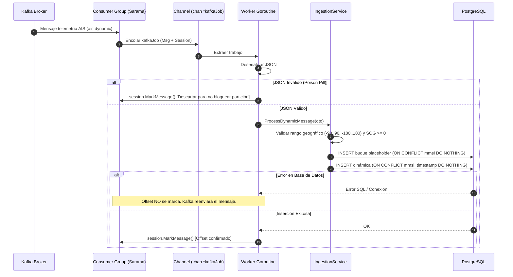

# ADR-001: Arquitectura de Ingesta AIS con Segregación CQRS, Pipeline Concurrente en Kafka y Persistencia Idempotente en PostgreSQL

## Estado
**Aceptado e Implementado** (Validado y fusionado en rama principal `master` mediante PR #6).

---

## Contexto y Problemática

El proyecto **MAGI (*Monitoreo y Análisis de Gases e Inmisiones*)** procesa datos telemétricos provenientes de buques mercantes para el cálculo y monitoreo en tiempo real de emisiones contaminantes en corredores marítimos críticos (e.g. Canal de Panamá y costas adyacentes).

La fuente primaria de información son las transmisiones de radio del protocolo internacional **AIS (*Automatic Identification System*)**, divididas principalmente en dos clases de mensajes emitidos con frecuencias y contenidos dispares:
1. **Mensajes Estáticos (Tipo 5):** Transmitidos periódicamente cada 6 minutos o tras cambios de itinerario. Contienen la identidad del barco: código MMSI (9 dígitos), número IMO (7 dígitos), nombre de la nave (*shipname*), indicativo de llamada (*callsign*) y tipología del buque.
2. **Mensajes Dinámicos (Tipos 1, 2 y 3):** Transmitidos con alta frecuencia (desde cada 2 a 10 segundos según velocidad y maniobra de la nave). Transportan telemetría cinemática: coordenadas GPS (latitud/longitud), velocidad sobre el fondo (SOG en nudos), rumbo sobre el fondo (COG), encabezamiento (*heading*), velocidad de giro (*ROT*) y estado de navegación.

### Desafíos Arquitectónicos Identificados
* **Asincronía y Desorden Temporal de Ingesta:** En un entorno distribuido con múltiples estaciones receptoras NMEA/AIS, los mensajes dinámicos frecuentemente llegan a la cola de mensajería antes de que se haya recibido o procesado la ficha estática del buque. Una clave foránea estricta sin manejo previo causaría rechazos masivos de inserción.
* **Sobrecarga Asimétrica (Lectura vs. Escritura):** El volumen de escritura es continuo, masivo y dependiente del tráfico marítimo en tiempo real (cientos de mensajes por segundo), mientras que las consultas de la API REST responden a dashboards web, analistas ambientales y procesos batch de cálculo de emisiones. El acoplamiento de ambas responsabilidades en un único proceso competía directamente por recursos de CPU, memoria y pools de base de datos.
* **Garantía de No Pérdida de Datos (*At-Least-Once*):** Las fallas transitorias de red o reinicios de contenedores no deben provocar pérdida de telemetría, pues los cálculos de emisiones requieren series de tiempo continuas.
* **Idempotencia ante Reintentos:** En caso de rebalanceo de particiones en Apache Kafka o reconexión de workers, el procesamiento de mensajes duplicados no debe corromper la base de datos ni provocar errores de unicidad descontrolados.

---

## Decisión de Arquitectura

Se ha diseñado e implementado una arquitectura basada en **CQRS (*Command Query Responsibility Segregation*)**, desacoplando el flujo de escritura del flujo de lectura, combinada con un pipeline de ingesta concurrente con **Apache Kafka** y un motor de almacenamiento relacional optimizado en **PostgreSQL**.

### 1. Segregación CQRS y Binarios Especializados
El código base comparte los paquetes de dominio (`internal/ais`) e infraestructura (`internal/database`, `internal/config`), pero compila en binarios y procesos de ejecución independientes:

* **Microservicio Ingestor (`magi-worker` / `cmd/worker` - Write Path):**
  * Responsable único de conectarse al clúster de Kafka mediante Consumer Groups.
  * Ejecuta validaciones náuticas bajo norma ITU-R M.1371.
  * Realiza inserciones atómicas e idempotentes en PostgreSQL.
  * No expone puertos de red abiertos ni endpoints HTTP públicos.
* **Microservicio de Consultas (`magi-api` / `cmd/api` - Read Path):**
  * Servidor HTTP de alto desempeño sobre el framework **Gin**.
  * Expone endpoints REST paginados (`GET /api/v1/ship/:imo`, `GET /api/v1/ship/mmsi/:mmsi`).
  * Implementa paginación defensiva (`limit` acotado entre 1 y 500, `offset` controlado) y ordenamiento cronológico inverso (`timestamp DESC`).
  * Provee un endpoint de monitoreo de salud profundo (`GET /health`) que evalúa la reactividad del pool de base de datos mediante `PingContext`.
  * No carga drivers, clientes ni dependencias de Kafka.
* **Binario Unificado de Desarrollo (`magi-service` / `cmd/main.go`):**
  * Mantiene la capacidad de levantar concurrentemente el worker y la API en un solo proceso para entornos de desarrollo local rápidos o tests de integración.

### 2. Ingesta Concurrente con Kafka Consumer Group y Worker Pool
* **Tópicos:** `ais.static` (mensajes tipo 5) y `ais.dynamic` (mensajes tipos 1, 2 y 3).
* **Consumer Group:** Emplea la librería `IBM/sarama` con estrategia de balanceo `RoundRobin` y commit automático vinculado a marcación manual.
* **Pipeline en Memoria:** El callback `ConsumeClaim` no procesa directamente ni bloquea el hilo de lectura de Kafka; en su lugar, deposita un objeto `kafkaJob` (mensaje + sesión activa) en un canal buferizado (`chan *kafkaJob`, capacidad 500).
* **Worker Pool:** Un conjunto configurable de 5 workers concurrentes (`WorkerPool = 5`) drena el canal, ejecuta deserialización JSON y delega en el servicio de negocio.

### 3. Garantía At-Least-Once e Inmunidad ante *Poison Pills*
* **Commit Tardío del Offset:** La instrucción `session.MarkMessage(job.msg, "")` se ejecuta **únicamente después** de que la transacción de base de datos haya finalizado exitosamente (`processed == true`). Si el worker sufre una falla fatal durante la escritura, Kafka retiene el offset y reentregará el mensaje al restaurarse el consumidor.
* **Descarte de Cargas Tóxicas (*Poison Pills*):** Si un mensaje AIS presenta JSON corrupto o tipos de datos irreconocibles que impidan su deserialización, el error es registrado en log y se ejecuta `session.MarkMessage` para avanzar el offset. Esto evita bucles infinitos de reinicio que detendrían la ingesta de la partición completa.

### 4. Idempotencia y Resolución de Buques "Fantasma" en PostgreSQL
* **Idempotencia en Telemetría:** La tabla `DBDynamicAIS` cuenta con un índice único compuesto `(mmsi, timestamp)`. La inserción se ejecuta mediante:
  ```go
  r.db.Clauses(clause.OnConflict{DoNothing: true}).Create(&dynamicMessage)
  ```
  Si Kafka reenvía un paquete ya registrado, la base de datos ignora la colisión en silencio sin generar fallos ni abortar transacciones.
* **Pre-creación Atómica del Buque (Manejo de Out-of-Order):** Para permitir que un mensaje dinámico se persista aun si el estático no ha llegado, `SaveDynamic` ejecuta previamente un `INSERT ... ON CONFLICT (mmsi) DO NOTHING` de un buque marcador (*placeholder*) con nombre `"UNKNOWN"`. Cuando posteriormente arribe el mensaje estático, `SaveStatic` ejecuta un `FirstOrCreate / Assign` actualizando los metadatos completos sin duplicar la clave primaria.

### 5. Validaciones de Dominio Náutico (Norma ITU-R M.1371)
En `internal/ais/service.go`, se aplican invariantes antes de cualquier operación de base de datos:
* MMSI estrictamente positivo (> 0).
* IMO verificado en el rango estándar marítimo de 7 dígitos (`1000000 <= imo <= 9999999`).
* Coordenadas geográficas válidas: Latitud $\in [-90.0, 90.0]$ y Longitud $\in [-180.0, 180.0]$.
* Velocidad sobre el fondo (*Speed Over Ground*) no negativa ($\ge 0$).

### 6. Contenedorización Multi-Stage y Despacho Dinámico
* **Dockerfile Multi-Stage:** Utiliza `golang:1.25.0-alpine` como builder compilando con `CGO_ENABLED=0`, `-ldflags="-s -w"` y `-trimpath`. La imagen de runtime se basa en `alpine:3.21` ejecutando bajo usuario no privilegiado (`appuser:appgroup`).
* **Dispatcher Entrypoint:** El script `scripts/entrypoint.sh` permite configurar la imagen mediante argumento de comando o vía variable de entorno `SERVICE_ROLE` (`api` | `worker` | `monolith`), facilitando su orquestación en plataformas PaaS/Dokploy o Docker Compose.

---

## Diagrama de Arquitectura

```mermaid
flowchart TD
    subgraph Fuentes["Fuentes de Señales Marítimas"]
        AIS_SRC["Receptores Costeros / Satelitales (NMEA)"]
        PRODUCER["Kafka Producer / Ingestion Gateway"]
    end

    subgraph KafkaCluster["Apache Kafka (KRaft Mode)"]
        TOPIC_STATIC["Tópico: ais.static (Tipo 5)"]
        TOPIC_DYNAMIC["Tópico: ais.dynamic (Tipos 1/2/3)"]
    end

    subgraph WritePath["WRITE PATH: magi-worker"]
        CG["Sarama Consumer Group<br/>(Group ID: magi-consumer-group)"]
        CHAN["Buffered Job Channel (cap: 500)"]
        WPOOL["Worker Pool Concurrente (x5 Goroutines)"]
        VAL_SVC["ais.IngestionService<br/>(Validación ITU-R M.1371)"]
        REPO_W["ais.Repository (Write Engine)"]
    end

    subgraph Persistence["Almacenamiento Relacional"]
        DB[(PostgreSQL 16 Engine)]
        TABLE_STATIC[("Tabla: static_ais<br/>PK: id, UQ: mmsi")]
        TABLE_DYNAMIC[("Tabla: dynamic_ais<br/>UQ Composite: mmsi + timestamp")]
    end

    subgraph ReadPath["READ PATH: magi-api"]
        CLIENTS["Clientes / Frontend MAGI / Analítica"]
        GIN["Gin HTTP Server (:8080)"]
        HEALTH["/health (DB Ping Probe)"]
        QUERY_SVC["ais.QueryService"]
        REPO_R["ais.Repository (Read Engine)"]
    end

    AIS_SRC --> PRODUCER
    PRODUCER --> TOPIC_STATIC
    PRODUCER --> TOPIC_DYNAMIC

    TOPIC_STATIC --> CG
    TOPIC_DYNAMIC --> CG
    CG -->|ConsumeClaim| CHAN
    CHAN --> WPOOL
    WPOOL -->|Deserializa & Valida| VAL_SVC
    VAL_SVC --> REPO_W

    REPO_W -->|1. Insert Placeholder Buque (ON CONFLICT DO NOTHING)| TABLE_STATIC
    REPO_W -->|2. Insert Telemetría (ON CONFLICT DO NOTHING)| TABLE_DYNAMIC
    REPO_W -.->|3. Post-Persist: session.MarkMessage()| CG

    CLIENTS -->|GET /api/v1/ship/:imo| GIN
    CLIENTS -->|GET /api/v1/ship/mmsi/:mmsi| GIN
    CLIENTS -->|GET /health| HEALTH
    HEALTH -->|PingContext| DB

    GIN --> QUERY_SVC
    QUERY_SVC --> REPO_R
    REPO_R -->|SELECT con Preload paginado| TABLE_STATIC
    TABLE_STATIC -.->|Join Foreign Key MMSI| TABLE_DYNAMIC
```

---

## Diagrama de Secuencia: Flujo de Ingesta At-Least-Once



---

## Alternativas Consideradas y Evaluadas

### 1. Monolito Acoplado Tradicional (Ingestor y API en un único proceso)
* **Descripción:** Mantener un solo binario donde el servidor HTTP y el consumidor de Kafka corran juntos.
* **Razón de Descarte:** En picos de tráfico marítimo, la concurrencia de inserción satura las conexiones a la base de datos y la CPU del contenedor, degradando los tiempos de respuesta de la API REST que atiende a los usuarios del sistema de monitoreo. La separación en microservicios permite autoescalar los workers de Kafka independientemente de las réplicas del servidor web.

### 2. Consumo Síncrono Directo en `ConsumeClaim` (Sin Worker Pool)
* **Descripción:** Procesar e insertar en base de datos de manera secuencial en el ciclo de lectura de Sarama.
* **Razón de Descarte:** El procesamiento síncrono bloquea el heartbeat del Consumer Group. Ante demoras temporales de la base de datos, el broker asume que el consumidor murió y desencadena rebalanceos continuos (*rebalance storm*), degradando drásticamente el throughput.

### 3. Confirmación Automática de Offsets de Kafka (*At-Most-Once Delivery*)
* **Descripción:** Habilitar el commit de offsets periódico e indiscriminado por tiempo antes de confirmar la persistencia.
* **Razón de Descarte:** Si el servicio sufriera un fallo catastrófico (OOM, caída de nodo) tras recibir el mensaje pero antes de escribir en disco, los datos se perderían irreversiblemente, generando vacíos en el cálculo ambiental de gases.

### 4. Bases de Datos de Series Temporales (TimescaleDB / InfluxDB) vs. PostgreSQL Estándar
* **Evaluación:** Aunque TimescaleDB ofrece ventajas notables para telemetría pura, la fase actual de MAGI requiere correlación estricta entre atributos relacionales fijos (características de motor, tipo de combustible, banderas) y telemetría.
* **Decisión:** Iniciar con PostgreSQL 16 relacional estándar aplicando índices compuestos cuidadosamente diseñados. La migración a hipertablas TimescaleDB queda planificada como evolución transparente sin alterar el contrato de dominio.

---

## Consecuencias del Diseño

### Positivas
1. **Aislamiento de Cargas y Escalabilidad Independiente:** `magi-worker` puede escalarse horizontalmente según el número de particiones de los tópicos de Kafka, mientras que `magi-api` escala de acuerdo a la demanda de los clientes web y analistas.
2. **Cero Registros Duplicados:** La combinación de commits at-least-once con cláusulas `ON CONFLICT DO NOTHING` en índices compuestos proporciona idempotencia exacta ante reintentos.
3. **Resiliencia ante Desorden de Eventos:** La creación preventiva de placeholders `"UNKNOWN"` resuelve automáticamente las violaciones de clave foránea causadas por la naturaleza no determinista del tráfico AIS.
4. **Baja Huella de Recursos:** Imágenes Docker de aproximadamente ~25 MB compiladas estáticamente en Go, operando con consumos de memoria base inferiores a 30 MB por contenedor.
5. **Observabilidad Inmediata:** Health check desacoplado y profundo en la API con validación de ping SQL (`GET /health`), compatible con Kubernetes Liveness/Readiness probes y Dokploy.

### Negativas y Mitigaciones
1. **Buques Temporales con Nombre "UNKNOWN":**
   * *Impacto:* Durante una ventana de tiempo corta, un buque puede figurar en base de datos con su identificador MMSI pero sin nombre comercial ni IMO hasta que arribe su mensaje tipo 5.
   * *Mitigación:* La API maneja elegantemente este estado y la ingesta estática actualiza atómicamente el registro tan pronto como es transmitido.
2. **Coordinación de Pools de Conexiones:**
   * *Impacto:* Al ejecutar múltiples instancias de `magi-worker` y `magi-api`, la suma de conexiones máximas (`SetMaxOpenConns = 25`) puede agotar los límites del servidor PostgreSQL (`max_connections`).
   * *Mitigación:* Se ha dimensionado el pool con límites conservadores y se prevé incorporar un PgBouncer en el entorno de producción si el número de réplicas se incrementa.

---

## Referencias y Estándares
* **Recomendación ITU-R M.1371-5:** *Technical characteristics for an automatic identification system using time division multiple access in the VHF maritime mobile frequency band.*
* **Patrón CQRS:** Martin Fowler, *Command Query Responsibility Segregation*.
* **Semántica de Mensajería:** Apache Kafka Documentation — *Message Delivery Guarantees*.
