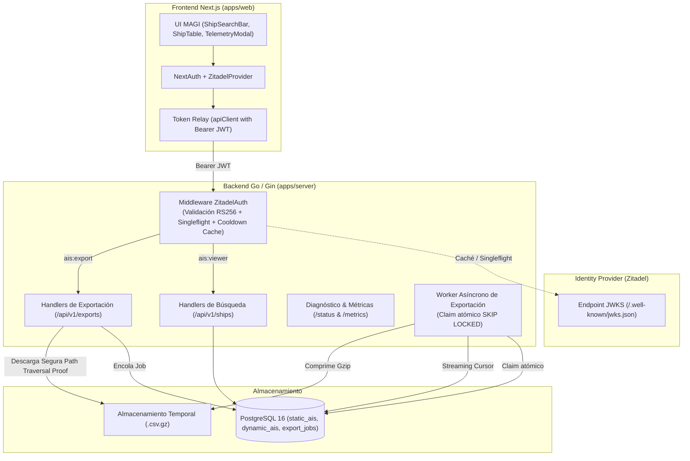

> 🧭 **Proyecto:** [[Projects/MAGI-backend/00-Index|MAGI-backend]] | [[Projects/MAGI-backend/Architecture/ADRs/ADR-001-arquitectura-cqrs-ingesta-kafka-postgresql|⬅️ Ver ADR-001]]

# ADR-002: Autenticación Descentralizada con Zitadel (Token Relay), Búsqueda Facetada y Exportación Asíncrona Resiliente

## Contexto y Problemática
En la evolución de MAGI (*Monitoreo y Análisis de Gases e Inmisiones*) para soportar interfaces de usuario en Next.js 16 dentro del monorepo, surgieron tres requerimientos de arquitectura críticos:
1. **Autenticación y Autorización Federada:** Proteger los endpoints de telemetría de buques mediante roles granulares (`ais:viewer` para consultas de flota y `ais:export` para descargas masivas) sin acoplar credenciales ni estado de sesión en la base de datos relacional de MAGI.
2. **Consultas de Flota Eficientes:** Proveer búsqueda facetada por nombre parcial (case-insensitive), IMO, MMSI y tipo de buque, además de telemetría acotada a rangos temporales ISO8601 sin degradar la base de datos operativa.
3. **Descarga Masiva Resiliente (Memory-Safe):** Permitir exportaciones de millones de registros de telemetría sin provocar desbordamientos de memoria RAM en el servidor ni bloqueos HTTP por timeout en proxies o navegadores.

---

## Decisión Arquitectónica

### 1. Patrón Token Relay con Verificación Criptográfica Local en Gin
- El cliente Next.js maneja la sesión con NextAuth (Zitadel Provider) e inyecta el `accessToken` en la cabecera `Authorization: Bearer <token>`.
- Gin valida la firma RS256 localmente consultando la clave pública en el JWKS de Zitadel.
- **Protección DoS:** Se implementa `golang.org/x/sync/singleflight` y una ventana de enfriamiento de 1 minuto para evitar que ráfagas de tokens con `kid` aleatorios saturen al IdP.
- **Validación Estricta:** Se rechazan tokens sin reclamo `exp` o expirados con `401 Unauthorized`.

### 2. Búsqueda Facetada e Historial Temporal
- Endpoint `GET /api/v1/ships` con filtrado por `LOWER(shipname) LIKE LOWER(?)`, `imo`, `mmsi` y `ship_type`, con paginación acotada (`limit`, `offset`) y conteo total.
- Endpoint `GET /api/v1/ships/:mmsi/telemetry` con rango temporal RFC3339 `[from, to]`.

### 3. Worker de Exportación Asíncrona Resiliente
- La solicitud de exportación (`POST /api/v1/exports`) crea un registro en `export_jobs` con estado `pending`.
- El worker en segundo plano reclama los trabajos de forma atómica utilizando `FOR UPDATE SKIP LOCKED`, previniendo condiciones de carrera en arquitecturas multi-pod.
- Los registros se leen de PostgreSQL mediante cursor (`rows.Next()`) y se escriben directamente en un flujo comprimido `gzip.Writer` y `csv.Writer`, garantizando un uso constante $O(1)$ de memoria RAM.
- Las descargas (`GET /api/v1/exports/:id/download`) están protegidas contra Path Traversal mediante `filepath.Rel` sobre el directorio autorizado.

---

## Consecuencias y Beneficios

### Positivas
1. **Seguridad y Desacoplamiento:** El backend no almacena contraseñas ni sesiones; la identidad y los roles se delegan íntegramente a Zitadel OIDC.
2. **Eficiencia de Recursos:** La exportación asíncrona previene picos de consumo de memoria RAM y caídas por OOM.
3. **Escalabilidad Horizontal:** El bloqueo con `SKIP LOCKED` permite escalar múltiples réplicas de `magi-api` y `magi-worker` de forma segura.
4. **Métricas Estables:** La normalización de rutas no coincidentes (`path = "not_found"`) protege el colector de Prometheus contra explosiones de cardinalidad.
