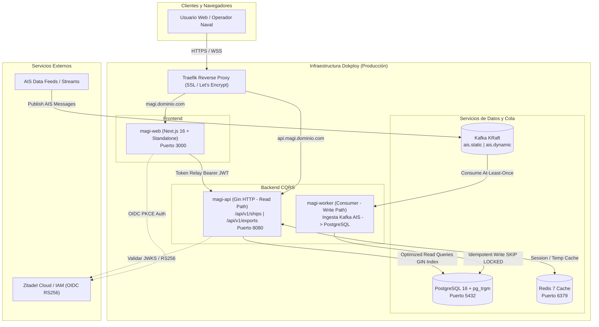

> 🧭 **Navegación:** [[Projects/MAGI-backend/00-Index|⬅️ Índice del Proyecto]] | [[Projects/MAGI-backend/Dev/Tasks-Active|Tareas Activas]]

# 🚀 Guía Integral de Despliegue: Desarrollo, Staging y Producción (Dokploy)

Este documento detalla la arquitectura de despliegue, la configuración de variables de entorno y los procedimientos operativos estándar (SOP) para desplegar el monorepositorio **MAGI** en sus tres ciclos de vida: **Desarrollo Local**, **Staging (Pre-producción)** y **Producción (mediante Dokploy)**.

---

## 🏗️ 1. Arquitectura de Despliegue y Segregación CQRS

El sistema MAGI implementa una arquitectura desacoplada donde el frontend web y los microservicios backend operan bajo el patrón **CQRS**:



---

## 💻 2. Entorno de Desarrollo (Local)

El entorno local permite dos modalidades: **Híbrida** (servicios de datos en Docker + binarios y Next.js en host para hot-reload) o **Dockerizada**.

### Requisitos Previos
- **Go**: 1.23+ o 1.25+
- **Bun**: 1.1+
- **Docker & Docker Compose**: v2.20+
- **PostgreSQL Client / psql** (opcional)

### Modalidad Híbrida Recomendada (Hot-Reloading)

#### Paso 1: Levantar los servicios de infraestructura
Desde la raíz del monorepositorio:
```bash
# Iniciar PostgreSQL, Redis y Kafka en modo KRaft
docker compose up -d postgres redis kafka
```
Verificar que los tres contenedores estén en estado `healthy`:
```bash
docker compose ps
```

#### Paso 2: Configurar variables de entorno locales
Crear los archivos de configuración en cada workspace:

**En `apps/server/.env`:**
```env
PORT=8080
DATABASE_DSN="host=localhost user=magi password=secret dbname=magi port=5432 sslmode=disable"
REDIS_URL="redis://localhost:6379"
CORS_ORIGIN="http://localhost:3000,http://localhost:3001"
LOG_LEVEL="debug"

# Zitadel IAM
ZITADEL_ISSUER="https://tu-instancia.zitadel.cloud"
ZITADEL_JWKS_URL="https://tu-instancia.zitadel.cloud/oauth/v2/keys"
ZITADEL_AUDIENCE="magi-backend"

# Kafka Ingestor
KAFKA_BROKERS="localhost:9092"
KAFKA_STATIC_TOPIC="ais.static"
KAFKA_DYNAMIC_TOPIC="ais.dynamic"
KAFKA_GROUP_ID="magi-local-dev"
```

**En `apps/web/.env.local`:**
```env
NEXTAUTH_URL="http://localhost:3000"
NEXTAUTH_SECRET="dev-super-secret-key-32-chars-minimum"
NEXT_PUBLIC_API_URL="http://localhost:8080"

# Proveedor Zitadel NextAuth
ZITADEL_ISSUER="https://tu-instancia.zitadel.cloud"
ZITADEL_CLIENT_ID="tu-client-id@zitadel"
ZITADEL_CLIENT_SECRET="tu-client-secret"
```

#### Paso 3: Ejecutar los microservicios en terminales separadas
```bash
# Terminal 1: Servidor HTTP API (Go)
cd apps/server
go run ./cmd/server/main.go

# Terminal 2: Worker Ingestor Kafka (Go)
cd apps/server
go run ./cmd/worker/main.go

# Terminal 3: Frontend Web (Next.js con Bun)
cd apps/web
bun dev
```

---

## 🧪 3. Entorno de Staging (Pre-producción)

El entorno de staging replica la topología distribuida de producción en un host aislado o máquina virtual usando `docker-compose.yml` completo.

### Paso 1: Archivo de variables de Staging (`.env.staging`)
```env
# Entorno
NODE_ENV=production
LOG_LEVEL=info

# Dominios Staging
NEXTAUTH_URL=https://staging.magi.tudominio.com
NEXT_PUBLIC_API_URL=https://staging-api.magi.tudominio.com
CORS_ORIGIN=https://staging.magi.tudominio.com

# Zitadel Staging
ZITADEL_ISSUER=https://auth-staging.tudominio.com
ZITADEL_CLIENT_ID=magi-staging-web-id
ZITADEL_CLIENT_SECRET=staging-secret-key
ZITADEL_AUDIENCE=magi-backend-staging

# Base de Datos PostgreSQL
POSTGRES_USER=magi_staging
POSTGRES_PASSWORD=PasswordRobustoStaging2026!
POSTGRES_DB=magi_staging
DOCKER_DATABASE_DSN="host=postgres user=magi_staging password=PasswordRobustoStaging2026! dbname=magi_staging port=5432 sslmode=disable"

# Secretos
NEXTAUTH_SECRET=GenerarConOpensslRandHex32ParaStaging!
```

### Paso 2: Despliegue con Docker Compose
```bash
# Construir y levantar toda la pila en background
docker compose --env-file .env.staging up -d --build

# Monitorear logs de inicialización y migraciones
docker compose logs -f magi-api magi-worker
```

### Paso 3: Pruebas de Humo en Staging (Smoke Tests)
```bash
# 1. Healthcheck profundo de la API
curl -i https://staging-api.magi.tudominio.com/health

# 2. Métricas de Prometheus
curl -i https://staging-api.magi.tudominio.com/metrics

# 3. Estado de servicios protegidos (requiere token Bearer con rol sys:monitor)
curl -i -H "Authorization: Bearer <TOKEN_VALIDO>" https://staging-api.magi.tudominio.com/api/v1/system/status
```

---

## 🚢 4. Entorno de Producción con Dokploy

**Dokploy** es la plataforma elegida para orquestación ligera y despliegues rápidos basados en Docker, Git Webhooks y Traefik.

### Estrategia de Despliegue en Dokploy

En Dokploy se configuran **3 Aplicaciones** conectadas al repositorio GitHub `YESUBZERO/MAGI-backend`:

1. **`magi-web`**: Frontend Next.js en contenedor standalone.
2. **`magi-api`**: Servidor Gin REST (CQRS Read Path).
3. **`magi-worker`**: Worker concurrente de Kafka (CQRS Write Path, sin puertos públicos).
4. **Bases de Datos Dokploy**: PostgreSQL 16 y Redis 7 aprovisionados como instancias gestionadas en Dokploy (con backups automáticos en S3/MinIO).

---

### Configuración Paso a Paso en el Panel de Dokploy

#### Aplicación 1: `magi-api` (Backend HTTP)
1. En Dokploy, ir a **Projects** $\rightarrow$ Crear proyecto `MAGI-Production`.
2. Añadir un nuevo servicio: **Application**.
3. **Source Code**:
   - Provider: **GitHub**
   - Repository: `YESUBZERO/MAGI-backend`
   - Branch: `main` (o `feature/monorepo-migration`)
4. **Build Settings**:
   - Build Type: **Dockerfile**
   - Context Path: `/apps/server`
   - Dockerfile Path: `Dockerfile`
5. **Command & Ports**:
   - Command: `api` *(El entrypoint ejecutará `/usr/local/bin/magi-api`)*
   - Container Port: `8080`
6. **Environment Variables**:
   ```env
   PORT=8080
   DATABASE_DSN=host=dokploy-postgres-host user=magi_prod password=PROD_SECRET dbname=magi_prod port=5432 sslmode=require
   REDIS_URL=redis://dokploy-redis-host:6379
   CORS_ORIGIN=https://magi.tudominio.com
   LOG_LEVEL=info
   ZITADEL_ISSUER=https://auth.tudominio.com
   ZITADEL_JWKS_URL=https://auth.tudominio.com/oauth/v2/keys
   ZITADEL_AUDIENCE=magi-backend
   EXPORT_DIR=/var/magi/exports
   ```
7. **Persistent Storage**:
   - Crear volumen `magi_exports_volume` montado en `/var/magi/exports` para almacenar exportaciones `.csv.gz`.
8. **Domains**:
   - Host: `api.magi.tudominio.com`
   - Port: `8080`
   - HTTPS / Let's Encrypt: **Activado**
   - Healthcheck Path: `/health`

---

#### Aplicación 2: `magi-worker` (Ingestor Kafka AIS)
1. En el mismo proyecto de Dokploy, añadir otra **Application**.
2. **Source Code**: Mismo repositorio y rama que `magi-api`.
3. **Build Settings**:
   - Context Path: `/apps/server`
   - Dockerfile Path: `Dockerfile`
4. **Command & Ports**:
   - Command: `worker` *(El entrypoint ejecutará `/usr/local/bin/magi-worker`)*
   - **No configurar dominios ni exponer puertos públicos.**
5. **Environment Variables**:
   ```env
   DATABASE_DSN=host=dokploy-postgres-host user=magi_prod password=PROD_SECRET dbname=magi_prod port=5432 sslmode=require
   REDIS_URL=redis://dokploy-redis-host:6379
   KAFKA_BROKERS=kafka-cluster:9092
   KAFKA_STATIC_TOPIC=ais.static
   KAFKA_DYNAMIC_TOPIC=ais.dynamic
   KAFKA_GROUP_ID=magi-prod-workers
   LOG_LEVEL=info
   ```
6. **Replicas / Escalado**: Se pueden configurar 2 a 5 réplicas en Dokploy; el índice único en PostgreSQL y el offset commit por mensaje aseguran idempotencia estricta.

---

#### Aplicación 3: `magi-web` (Frontend Next.js)
1. En Dokploy, añadir una nueva **Application**.
2. **Source Code**:
   - Repository: `YESUBZERO/MAGI-backend`
   - Branch: `main`
3. **Build Settings**:
   - Build Type: **Dockerfile**
   - Context Path: `/apps/web`
   - Dockerfile Path: `Dockerfile`
4. **Container Port**: `3000`
5. **Environment Variables**:
   ```env
   NODE_ENV=production
   NEXTAUTH_URL=https://magi.tudominio.com
   NEXTAUTH_SECRET=GenerarLlaveAleatoria64CaracteresProd!
   NEXT_PUBLIC_API_URL=https://api.magi.tudominio.com
   ZITADEL_ISSUER=https://auth.tudominio.com
   ZITADEL_CLIENT_ID=magi-production-client-id
   ZITADEL_CLIENT_SECRET=super-secure-production-secret
   ```
6. **Domains**:
   - Host: `magi.tudominio.com`
   - Port: `3000`
   - HTTPS / Let's Encrypt: **Activado**
   - Redirección automática HTTP a HTTPS: **Activada**

---

## ⚡ 5. Despliegue Rápido Alternativo vía "Compose" en Dokploy

Si se prefiere levantar la arquitectura completa como un solo stack interconectado en Dokploy:
1. En Dokploy, crear un servicio de tipo **Compose**.
2. Seleccionar repositorio `YESUBZERO/MAGI-backend`.
3. Indicar el archivo `docker-compose.yml`.
4. Definir las variables en el editor de entorno de Dokploy.
5. Dokploy orquesta la red interna de Traefik y asigna certificados SSL automáticamente a los servicios que expongan puertos.

---

## 🛡️ 6. Matriz de Variables de Entorno por Entorno

| Variable | Desarrollo Local | Staging | Producción (Dokploy) |
|---|---|---|---|
| `PORT` | `8080` | `8080` | `8080` |
| `DATABASE_DSN` | `host=localhost ... sslmode=disable` | `host=postgres ... sslmode=disable` | `host=... sslmode=require` |
| `REDIS_URL` | `redis://localhost:6379` | `redis://redis:6379` | `redis://...` |
| `KAFKA_BROKERS` | `localhost:9092` | `kafka:9092` | `kafka-prod-cluster:9092` |
| `ZITADEL_ISSUER` | Instancia Dev / Test | Instancia Staging | Instancia Prod con Dominio Propio |
| `ZITADEL_AUDIENCE` | `magi-backend` | `magi-backend-staging` | `magi-backend` |
| `NEXTAUTH_URL` | `http://localhost:3000` | `https://staging.magi.tudominio.com` | `https://magi.tudominio.com` |
| `NEXT_PUBLIC_API_URL` | `http://localhost:8080` | `https://staging-api.magi.tudominio.com` | `https://api.magi.tudominio.com` |
| `LOG_LEVEL` | `debug` | `info` | `warn` o `info` |

---

## 🔄 7. Estrategia de CI/CD, Rollback y Monitoreo

### Continuous Deployment (Auto-Deploy)
En la configuración de cada aplicación en Dokploy:
- Activar **Auto Deploy**.
- Copiar el **Webhook URL** generado por Dokploy.
- En GitHub $\rightarrow$ `Settings` $\rightarrow$ `Webhooks`: Agregar la URL de Dokploy con trigger en eventos `push`. Cada merge a `main` desencadenará una compilación y despliegue sin tiempo de inactividad (*Zero-Downtime Rolling Update*).

### Procedimiento de Rollback Inmediato
Si una versión desplegada presenta anomalías:
1. En Dokploy $\rightarrow$ Seleccionar la aplicación afectada (`magi-api` o `magi-web`).
2. Ir a la pestaña **Deployments**.
3. Localizar el despliegue previo estable.
4. Presionar el botón **Rollback**. Dokploy cambiará el puntero del contenedor en Traefik en < 5 segundos sin recrear la infraestructura base.

### Monitoreo y Observabilidad en Producción
- **Métricas Prometheus**: Dokploy puede conectarse con Grafana/Prometheus apuntando a `https://api.magi.tudominio.com/metrics`.
- **Logs en Vivo**: Pestaña **Logs** en Dokploy con soporte de filtrado en tiempo real por contenedor.
- **Healthcheck Activo**: Traefik verifica cada 30 segundos `/health`; si una instancia falla, la retira del pool de balanceo antes de que impacte a los usuarios.
